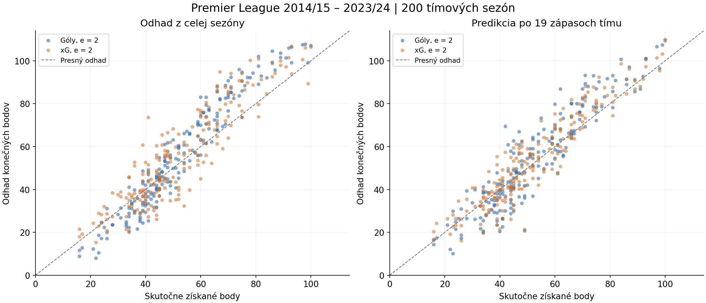
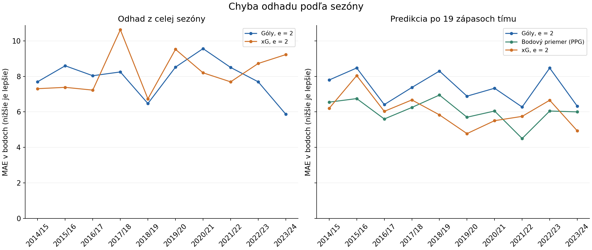

# Experiment 01: pevný Pythagorejský exponent

## Dáta a výber

Zdroj: [https://www.kaggle.com/datasets/codytipton/understat-data](https://www.kaggle.com/datasets/codytipton/understat-data), používateľom dodaný archív `Understat-data.zip`.
Archív obsahuje 41,722 riadkov tím–zápas, 20,861
jedinečných zápasov a 35,076 hráčskych záznamov.
Overené obdobie zápasov: 2014-08-01 17:00:00 až 2024-09-29 19:00:00.

Experiment používa EPL, 10 kompletných sezón
2014/15 – 2023/24, 200 tímových sezón
a 3800 zápasov. Každý tím má 38 zápasov.
Výber závisí od úplnosti rozpisu, nie od výsledku modelu.
Neúplné sezóny aj dôvody vylúčenia sú v `season_selection.csv`.

## Metóda

Exponent **e = 2** je pevný pre oba modely a všetky sezóny. Neladí sa na dátach.
Pythagorejský podiel: `s = GF^2 / (GF^2 + GA^2)`; xG model nahrádza GF/GA za xG/xGA.
Pri nulovom GF aj GA sa výpočet zastaví; v použitých agregátoch taký prípad nenastal.

1. Retrospektívny odhad: `3 × 38 × s`, so vstupmi z celej sezóny.
2. Predikcia po 19 zápasoch tímu: `body_doteraz + 3 × (38 − 19) × s_doteraz`.
3. Referenčný model PPG: `38 × body_doteraz / 19`.

Pri predikcii sa góly, xG a už získané body počítajú iba z prvých 19
chronologických zápasov daného tímu. Dátum hranice je uložený pre každý tím.
Nejde o spoločný kalendárny dátum ani o oficiálne 19. kolo.
Konečné body vstupujú iba do vyhodnotenia. Počet 38 je známy rozpis sezóny.

**Cieľ sú body získané zo zápasov (3W + D), pred administratívnymi odpočtami.**
Dataset neobsahuje oficiálnu konečnú tabuľku ani históriu bodových trestov.
Preto výsledky neoznačujeme za predikciu oficiálneho bodového stavu po sankciách.

## Výsledky: retrospektívny odhad

| Model | MAE | RMSE | Bias |
| --- | ---: | ---: | ---: |
| Góly, e = 2 | 7.923 | 9.625 | +2.798 |
| xG, e = 2 | 8.267 | 10.318 | +3.192 |

## Výsledky: predikcia po 19 zápasoch

| Model | MAE | RMSE | Bias |
| --- | ---: | ---: | ---: |
| Góly, e = 2 | 7.365 | 9.338 | +1.218 |
| xG, e = 2 | 6.040 | 7.738 | +1.466 |
| Bodový priemer (PPG) | 6.040 | 7.537 | -0.110 |

Metriky sú v bodoch na tím. MAE je priemerná absolútna chyba; RMSE viac
penalizuje veľké chyby. Bias je priemer (odhad − skutočnosť).
Súhrn používa všetkých 200 tímových sezón, bez zaokrúhľovania odhadov.

| Sezóna | Góly MAE | xG MAE | PPG MAE |
| --- | ---: | ---: | ---: |
| 2014/15 | 7.798 | 6.200 | 6.550 |
| 2015/16 | 8.476 | 8.047 | 6.750 |
| 2016/17 | 6.412 | 6.031 | 5.600 |
| 2017/18 | 7.376 | 6.674 | 6.250 |
| 2018/19 | 8.302 | 5.833 | 6.950 |
| 2019/20 | 6.887 | 4.776 | 5.700 |
| 2020/21 | 7.334 | 5.505 | 6.050 |
| 2021/22 | 6.275 | 5.747 | 4.500 |
| 2022/23 | 8.472 | 6.658 | 6.050 |
| 2023/24 | 6.320 | 4.932 | 6.000 |





## Interpretácia a obmedzenia

Pri predikcii má xG oproti gólom o 18.0 % nižšiu celkovú MAE
a nižšiu MAE v 10 z 10 sezón.
Rozdiel MAE (xG − PPG) je +0.000307 bodu; kladná hodnota znamená
vyššiu chybu xG. RMSE je 7.738 pri xG a
7.537 pri PPG. Zlepšenie voči gólovému modelu teda
samo osebe neznamená zlepšenie voči bodovému priemeru.

Celosezónny odhad je opisný; jeho úspešnosť nedokazuje schopnosť predvídať
budúcnosť. Na tú slúži samostatné vyhodnotenie po 19 zápasoch.
PPG je dôležitá referencia: Pythagorejský model má zmysel posudzovať aj voči nemu,
nie iba porovnávať góly s xG navzájom.

Násobenie podielu tromi nemodeluje remízy a môže nadhodnocovať počet bodov.
Toto je jednoduchý benchmark, nie úplný futbalový model pravdepodobností.
Nerieši silu zostávajúcich súperov, domáce prostredie, prestupy ani zmenu formy.
Opakované tímy a sezóny nie sú nezávislé pozorovania. Rozdiely metrík sú opisné,
bez tvrdenia štatistickej významnosti alebo automatickej platnosti pre iné ligy.
Historická verzia xG nemusí byť totožná s hodnotami dostupnými v deň predikcie.

Ďalší experiment: explicitne zohľadniť remízy s parametrami z predchádzajúcich
sezón a zachovať chronologické testovanie. Až potom samostatne skúmať exponent.

## Reprodukcia

Z koreňa repozitára po inštalácii `python -m pip install -e ".[dev,analysis]"`:

```text
python -m football_analysis.pilot data/raw/Understat-data.zip
```

Audit je v `dataset_audit.json`, pokrytie v `dataset_coverage.csv`, profil
stĺpcov v `column_profile.csv`. `retrospective_predictions.csv` a
`forecast_predictions.csv` obsahujú všetky tímové odhady a chyby.
Parametre, SHA-256 vstupov a kódu, verzie knižníc a Git revízia sú v `metadata.json`.
Licencia/verzia Kaggle nie je pribalená v archíve; zatiaľ nebola potvrdená.
Zdrojové súbory zostávajú mimo Gitu podľa `.gitignore`.
