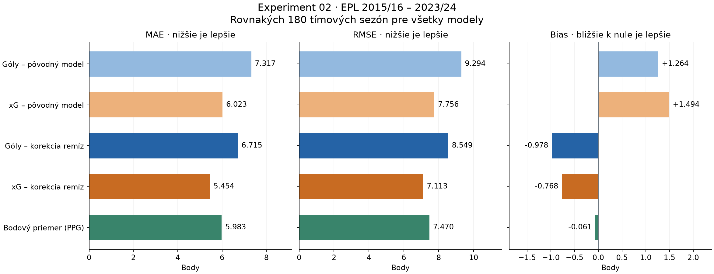
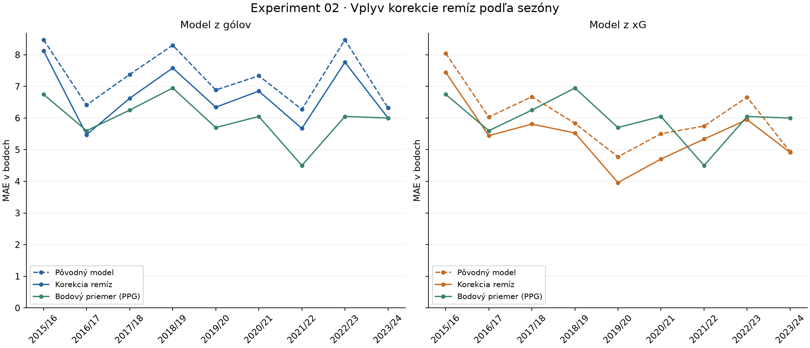

# Experiment 02: korekcia remíz v Pythagorejskom modeli

## Cieľ a rozsah

Overiť, či historický podiel remíz zlepší predikciu bodov pri pevnom exponente
**2**. Použitý je rovnaký lokálny Understat export ako v Experimente 01:
https://www.kaggle.com/datasets/codytipton/understat-data .

Hodnotíme **EPL 2015/16 – 2023/24**:
9 úplných sezón, **180 tímových sezón**, vždy 20 tímov a 38 zápasov.
Ročník **2014/15** je iba prvá kalibrácia. Vylúčené neúplné
ročníky: **2024/25**. Presné zaradenie je v `season_selection.csv`.
Pri neskorších predikciách sa kalibrácia rozširuje o všetky už ukončené sezóny.

**Všetkých päť modelov používa identické hodnotené riadky.** Pôvodné modely
z Experimentu 01 sú prepočítané na tejto menšej vzorke. Ich výsledky nemožno
priamo porovnávať s pôvodným súhrnom za 200 tímových sezón.

## Metodika

Z prvých **19** zápasov každého tímu spočítame góly/xG a získané body.
`N` je známy počet zápasov sezóny (38), `k` počet už odohraných zápasov.
Predikujeme konečný počet bodov:

```text
PE = GF^gamma / (GF^gamma + GA^gamma)
P_original = P_observed + 3 * (N - k) * PE
P_draw = P_observed + (3 - d_hist) * (N - k) * PE
P_PPG = N * P_observed / k
```

Pre xG model nahradíme GF/GA hodnotami xGF/xGA. Exponent `gamma = 2`
sa v tomto experimente neladí. PPG pri 19 z 38 zápasov jednoducho zdvojnásobí
už získané body; predpokladá rovnaké bodové tempo v zostávajúcej časti sezóny.
Korekcia mení iba odhad budúcich bodov, už získané body ostávajú nezmenené.

`d_hist = sum(draws) / sum(played)` používame iba z úplných predchádzajúcich
sezón EPL. Dva tímové pohľady na každý zápas sa v pomere vykrátia.
Pri remíze sa rozdelia 2 body, pri rozhodnutom zápase 3, teda historický
priemer celkových rozdelených bodov je `3 - d_hist`.
Násobenie týmto faktorom je **empirická ligová korekcia**. Nie je to samostatný
pravdepodobnostný model výhier a remíz a nevynucuje presný ligový súčet bodov.

## Ochrana pred použitím budúcich informácií

- Kalibrácia používa len predchádzajúce ročníky; podiel remíz hodnotenej sezóny
  do nej nevstupuje. Posledný kalibračný zápas musí byť pred dátumom každej predikcie.
- Góly, xG a body tímu pochádzajú iba z prvých `k` chronologických zápasov.
- Konečné body sú len cieľom vyhodnotenia. Testy menia budúce výsledky a
  overujú, že skoršie predikcie a ich kalibrácia ostanú rovnaké.
- Každý tím má vlastný `cutoff_date`; nejde o spoločný deň alebo oficiálne kolo.

**Cieľ = body zo zápasov (3W + D), pred administratívnymi odpočtami.**
Dataset neobsahuje históriu sankcií ani oficiálnu konečnú tabuľku po odpočtoch.

## Celkové výsledky

| Model | MAE (body) | RMSE (body) | Bias (body) |
| --- | ---: | ---: | ---: |
| Góly – pôvodný model | 7.317 | 9.294 | +1.264 |
| xG – pôvodný model | 6.023 | 7.756 | +1.494 |
| Góly – korekcia remíz | 6.715 | 8.549 | -0.978 |
| xG – korekcia remíz | 5.454 | 7.113 | -0.768 |
| Bodový priemer (PPG) | 5.983 | 7.470 | -0.061 |

Nižšie MAE a RMSE sú lepšie. Bias je priemer (predikcia − skutočnosť):
kladný znamená nadhodnotenie, záporný podhodnotenie. Metriky sú v bodoch.
Súhrn počíta chyby zo všetkých 180 riadkov; celkové RMSE nie je aritmetický
priemer sezónnych RMSE. Predikcie sa pred výpočtom metrík nezaokrúhľujú.



## Zmena oproti pôvodným modelom a PPG

| Model oproti referencii | Zmena MAE | Zmena RMSE | Zníženie MAE | Sezóny s nižšou MAE |
| --- | ---: | ---: | ---: | ---: |
| Góly – korekcia remíz oproti Góly – pôvodný model | -0.602 | -0.746 | 8.23 % | 9/9 |
| xG – korekcia remíz oproti xG – pôvodný model | -0.569 | -0.643 | 9.45 % | 9/9 |
| xG – korekcia remíz oproti Bodový priemer (PPG) | -0.530 | -0.357 | 8.85 % | 7/9 |

Zmena = korigovaný model mínus referencia; záporná zmena znamená zlepšenie.
xG s korekciou má oproti PPG o **8.85 % nižšiu
MAE** v súhrne. Výhoda však nie je rovnaká v každej sezóne.
Kladný pôvodný bias sa po korekcii mení na mierne podhodnocovanie; korekcia
teda systematickú chybu úplne neodstraňuje.

## MAE po sezónach

| Sezóna | Góly pôvodné | Góly s korekciou | xG pôvodné | xG s korekciou | PPG |
| --- | ---: | ---: | ---: | ---: | ---: |
| 2015/16 | 8.476 | 8.130 | 8.047 | 7.444 | 6.750 |
| 2016/17 | 6.412 | 5.473 | 6.031 | 5.443 | 5.600 |
| 2017/18 | 7.376 | 6.623 | 6.674 | 5.809 | 6.250 |
| 2018/19 | 8.302 | 7.581 | 5.833 | 5.529 | 6.950 |
| 2019/20 | 6.887 | 6.343 | 4.776 | 3.959 | 5.700 |
| 2020/21 | 7.334 | 6.851 | 5.505 | 4.705 | 6.050 |
| 2021/22 | 6.275 | 5.671 | 5.747 | 5.335 | 4.500 |
| 2022/23 | 8.472 | 7.765 | 6.658 | 5.949 | 6.050 |
| 2023/24 | 6.320 | 6.001 | 4.932 | 4.910 | 6.000 |

RMSE a bias po sezónach sú tiež uložené v `metrics.csv`.



## Historická kalibrácia

| Hodnotená sezóna | Historické sezóny | Zápasy | Remízy | d_hist | Faktor 3 − d_hist |
| --- | --- | ---: | ---: | ---: | ---: |
| 2015/16 | 2014–2014 | 380 | 93 | 0.2447 | 2.7553 |
| 2016/17 | 2014–2015 | 760 | 200 | 0.2632 | 2.7368 |
| 2017/18 | 2014–2016 | 1140 | 284 | 0.2491 | 2.7509 |
| 2018/19 | 2014–2017 | 1520 | 383 | 0.2520 | 2.7480 |
| 2019/20 | 2014–2018 | 1900 | 454 | 0.2389 | 2.7611 |
| 2020/21 | 2014–2019 | 2280 | 546 | 0.2395 | 2.7605 |
| 2021/22 | 2014–2020 | 2660 | 629 | 0.2365 | 2.7635 |
| 2022/23 | 2014–2021 | 3040 | 717 | 0.2359 | 2.7641 |
| 2023/24 | 2014–2022 | 3420 | 804 | 0.2351 | 2.7649 |

`calibration.csv` uvádza aj dátum posledného historického zápasu a najskorší
dátum predikcie v cieľovej sezóne, aby bolo možné skontrolovať časové oddelenie.

## Interpretácia a obmedzenia

Korekcia zlepšuje zvolený historický benchmark. Zatiaľ ide o **opisné
výsledky jednej ligy**, bez tvrdenia štatistickej významnosti alebo kauzality.
Tímové sezóny nie sú nezávislé pozorovania a máme len 9 hodnotených
ročníkov. Model explicitne nezohľadňuje zostávajúcich súperov, domáce prostredie
ani rozdielnu náchylnosť tímov na remízy. Historický export xG môže zahŕňať revízie,
ktoré v deň pôvodnej predikcie ešte neboli dostupné.

Experiment 02 je samostatný test korekcie pri pevnom exponente. Nasledujúci
Experiment 03 podľa pokynov konzultanta má optimalizovať exponent po ligách,
použiť validáciu po celých sezónach (pri desiatich úplných ročníkoch 5 behov
8 tréningových + 2 testovacie) a porovnať predikované poradie tímov s realitou.
Táto 5-násobná validácia nie je automaticky chronologická predikcia; pri jej
príprave treba presne oddeliť kalibráciu parametrov od testovacích sezón.

## Reprodukcia a výstupy

Z koreňa projektu, vo virtuálnom prostredí:

```text
python -m pip install -e ".[dev,analysis]"
python -m football_analysis.experiment_02
python -m pytest
```

CLI prijíma aj cestu k CSV, jeho priečinku alebo pôvodnému ZIP.
Výstupy sú v `reports/experiment_02`:

- `predictions.csv`: jednotlivé odhady, skutočné body, chyby a historický faktor.
- `metrics.csv`: MAE/RMSE/bias za každý model a sezónu aj súhrnne.
- `comparisons.csv`: rozdiely chýb a percentuálne zmeny na rovnakej vzorke.
- `calibration.csv`, `season_selection.csv`: história kalibrácie a výber sezón.
- `model_comparison.png`, `mae_by_season.png`: grafy odvodené z rovnakých metrík.
- `metadata.json`: hash vstupu a modulov, parametre, verzie knižníc a Git revízia.

Originálne dáta ostávajú lokálne; do commitu patria kód, testy, dokumentácia
a kompaktné výsledky experimentu. Výsledky Experimentu 01 sa nemenia.
