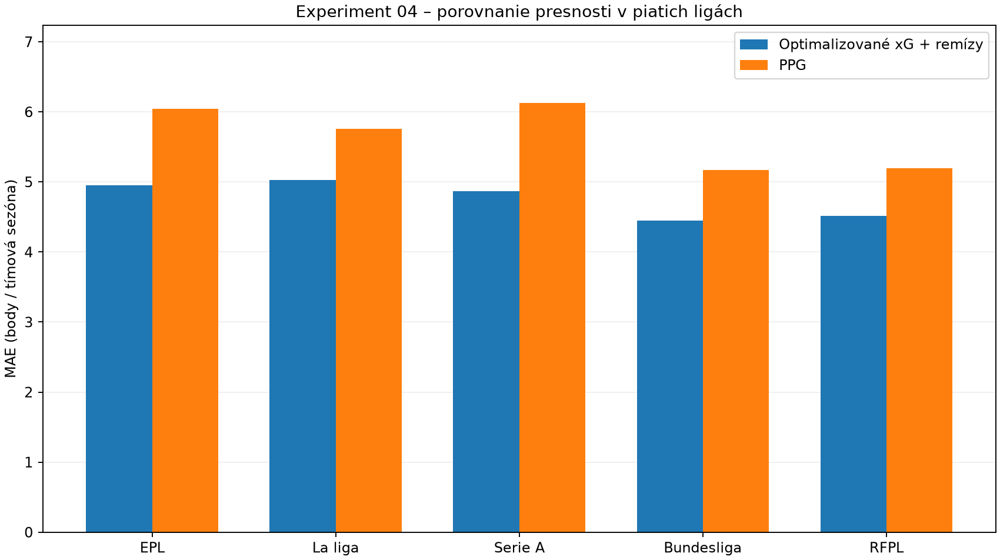
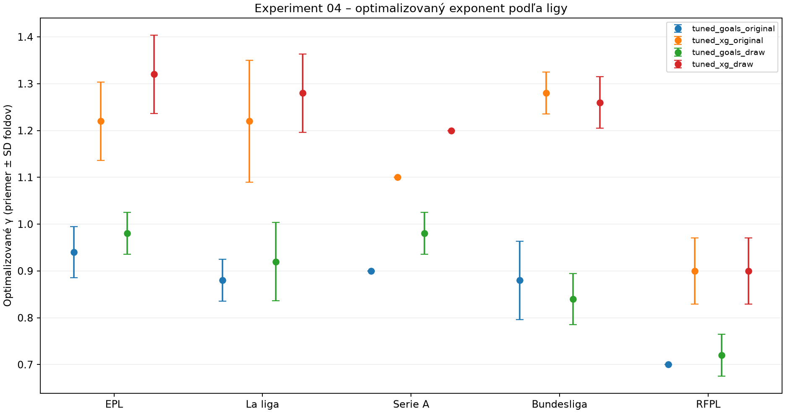

# Experiment 04 – optimalizácia Pytagorovho exponentu v rôznych ligách

## Cieľ a metodika

Rozšírenie Experimentu 03 na päť súťaží s **desiatimi kompletnými sezónami 2014/15–2023/24**.
Každá liga sa kalibruje **samostatne**, bez miešania údajov medzi ligami.
V každom z 5 foldov sa používajú **8 celých sezón na tréning a 2 na test**.
Každá testovacia sezóna sa použije práve raz. Vstupy do predikcie tvoria
prvé zápasy každého tímu: EPL/La Liga/Serie A **19 z 38**, Bundesliga **17 z 34**
a RFPL **15 z 30**.
Pytagorov exponent γ sa pre každý variant optimalizuje pomocou tréningovej MAE na mriežke **0.5–3** (krok 0,1).
Podiel remíz sa odhaduje iba z trénovacích sezón aktuálnej ligy a foldu.
Hlavné vopred určené porovnanie: **optimalizovaný xG model s korekciou remíz proti PPG**.
Všetky modely v jednej lige sa testujú na totožných tímových sezónach.

**Časová interpretácia:** foldy 1–4 sú retrospektívna CV a môžu trénovať aj na novších sezónach
než testované. **Iba fold 5** (test 2022/23 a 2023/24) je chronologický holdout.
Výsledky nie sú prospektívnym nasadením ani dôkazom štatistickej významnosti.

## Audit sezón a výber líg

| Liga | Kompletné sezóny v zdroji | Zahrnuté do 5-fold CV | Poznámka |
| --- | ---: | --- | --- |
| EPL | 10 | Áno | 10 homogénnych ročníkov |
| La liga | 10 | Áno | 10 homogénnych ročníkov |
| Serie A | 10 | Áno | 10 homogénnych ročníkov |
| Bundesliga | 10 | Áno | 10 homogénnych ročníkov |
| RFPL | 10 | Áno | 10 homogénnych ročníkov |
| Ligue 1 | 9 | Nie | Ligue 1: neúplná 2019/20 a zmena počtu tímov na 18 v 2023/24 |

Podrobný výber, dôvody vylúčenia a počet zápasov sú v `league_audit.csv`.
Ročník 2024/25 je v dodanom exporte neúplný a nie je hodnotený.
Ligue 1 má v exporte **9 dokončených sezón**; preto na ňu nemožno použiť
identický postup 5 × (8 tréningových + 2 testovacie) bez zmeny metodiky.

## Hlavné výsledky – optimalizované xG + remízy vs. PPG

| Liga | Tímy | Hranica | MAE xG+remízy | MAE PPG | Zlepšenie MAE | RMSE xG+remízy |
| --- | ---: | ---: | ---: | ---: | ---: | ---: |
| EPL | 20 | 19 | 4.952 | 6.040 | +18.01 % | 6.210 |
| La liga | 20 | 19 | 5.027 | 5.755 | +12.65 % | 6.158 |
| Serie A | 20 | 19 | 4.867 | 6.130 | +20.60 % | 6.213 |
| Bundesliga | 18 | 17 | 4.449 | 5.172 | +13.99 % | 5.560 |
| RFPL | 16 | 15 | 4.517 | 5.194 | +13.03 % | 5.632 |

Zlepšenie = 100 × (MAE_PPG − MAE_model) / MAE_PPG. Kladná hodnota znamená nižšiu chybu modelu.
Rôzna dĺžka sezóny ovplyvňuje absolútnu MAE v bodoch; relatívne zlepšenie voči
ligovému PPG benchmarku je preto užitočné doplnkové porovnanie.

## Stabilita exponentu γ medzi ligami

Priemer a smerodajná odchýlka z piatich samostatne kalibrovaných foldov:

| Liga | Góly bez remíz | xG bez remíz | Góly + remízy | xG + remízy |
| --- | ---: | ---: | ---: | ---: |
| EPL | 0.94 ± 0.05 | 1.22 ± 0.08 | 0.98 ± 0.04 | 1.32 ± 0.08 |
| La liga | 0.88 ± 0.04 | 1.22 ± 0.13 | 0.92 ± 0.08 | 1.28 ± 0.08 |
| Serie A | 0.90 ± 0.00 | 1.10 ± 0.00 | 0.98 ± 0.04 | 1.20 ± 0.00 |
| Bundesliga | 0.88 ± 0.08 | 1.28 ± 0.04 | 0.84 ± 0.05 | 1.26 ± 0.05 |
| RFPL | 0.70 ± 0.00 | 0.90 ± 0.07 | 0.72 ± 0.04 | 0.90 ± 0.07 |

## Párové rozdiely podľa validačných foldov

Rozdiel MAE (optimalizované xG+remízy mínus PPG) sa počíta na rovnakých testovacích sezónach.
Záporný rozdiel znamená zlepšenie oproti PPG:

| Liga | Priemer rozdielu MAE | SD rozdielu | Foldy s nižšou MAE |
| --- | ---: | ---: | ---: |
| EPL | -1.088 | 0.560 | 5/5 |
| La liga | -0.728 | 0.640 | 4/5 |
| Serie A | -1.263 | 1.067 | 5/5 |
| Bundesliga | -0.724 | 0.637 | 5/5 |
| RFPL | -0.677 | 0.211 | 5/5 |

Týchto päť výsledkov nie je nezávislých pri odhadovaní neistoty, pretože tréningové
množiny sa prekrývajú a ročníky jednej ligy sa môžu podobať. Uvádzame len **opisnú štatistiku**
bez testov významnosti alebo zavádzajúcich intervalov spoľahlivosti.

## Chronologický holdout (fold 5)

| Liga | γ (xG + remízy) | MAE modelu | MAE PPG |
| --- | ---: | ---: | ---: |
| EPL | 1.2 | 5.272 | 6.025 |
| La liga | 1.4 | 4.942 | 5.850 |
| Serie A | 1.2 | 5.255 | 6.150 |
| Bundesliga | 1.3 | 4.399 | 4.444 |
| RFPL | 0.9 | 4.517 | 5.156 |

## Obmedzenia

- xG pochádza z historického exportu a mohlo byť dodatočne upravené.
- Cieľové body predstavujú 3W + D, nie oficiálnu tabuľku po administratívnych odpočtoch.
- Poradie a Top-4 sú odvodené iba z bodov (pri rovnosti bez oficiálnych pomocných kritérií).
- Ligy sa líšia počtom zápasov; hodnotíme podiel sezóny, nie spoločný počet 19 zápasov.
- Exponenty vybrané pomocou 5-fold CV môžu kolísať; rozdiely nepreukazujú kauzalitu.
- Výber najlepšieho modelu podľa testovacej MAE by si vyžadoval ďalší nezávislý test;
  preto ako hlavný porovnávame **vopred zvolený variant** z Experimentu 03.

## Reprodukcia a súbory

Spustenie: `python -m football_analysis.experiment_04` po inštalácii závislostí a dodaní
`data/raw/understat/game_stats.csv`. Všetky výsledky sa generujú automaticky.

- `league_audit.csv` – validácia kompletnosti všetkých šiestich líg.
- `league_summary.csv` – hlavné medziligové výsledky.
- `overall_metrics.csv`, `fold_metrics.csv` – modelové metriky a validačné foldy.
- `gamma_by_league.csv`, `gamma_tuning.csv` – prehľad a mriežka exponentov.
- `paired_fold_differences.csv` – párové rozdiely oproti PPG a fixnému xG modelu.
- `predictions.csv`, `folds.csv` – jednotlivé predikcie a rozdelenie sezón.
- `mae_by_league.png`, `gamma_by_league.png`, `metadata.json`, `report.md`.
